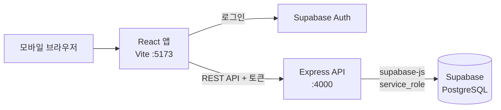

# 청해 — 부산 청년 정책 한눈에

3학년 2학기 소프트웨어공학(임한신) 프로젝트

부산 청년 지원정책·무료 교육·청년공간·문화 프로그램 정보를 한곳에서 찾고, 내 조건으로 신청 가능 여부를 확인하는 모바일 웹앱입니다.

---

## 1. 기술 스택

| 구분 | 기술 | 비고 |
|---|---|---|
| Frontend | React 19 + Vite | 모바일 우선 웹앱 (기준 폭 390px, 최대 480px) |
| 라우팅 | React Router | 하단 탭 5개 (홈 / 검색 / 지도 / 캘린더 / 마이) |
| 서버 상태 | TanStack Query | API 응답 캐싱, 로딩·에러 상태 관리 |
| 클라이언트 상태 | Zustand | 로그인 사용자 등 전역 상태 |
| HTTP | Axios | 프론트 → Express API, 로그인 토큰 자동 첨부 |
| Backend | Node.js + Express 5 | REST API |
| DB | Supabase (PostgreSQL) | 팀 공용 프로젝트 `SWproject` (조직 `SWEProject`, 서울 리전) |
| 인증 | Supabase Auth | 프론트에서 로그인, Express가 토큰 검증 |
| 코드 품질 | ESLint + Prettier | 저장 시 자동 정리 |

## 2. 구조



- **로그인**은 프론트가 Supabase Auth와 직접 처리하고, 받은 토큰을 API 요청 헤더에 담아 보냅니다.
- **데이터 조회·저장**은 전부 Express를 거칩니다. 자격 판정 같은 로직이 서버 한 곳에 모입니다.
- **신청 자격 판정**은 `backend/src/services/eligibility.service.js`에서 규칙 기반으로 계산합니다 (AI 미사용).

```
SWEProject/
├── frontend/
│   └── src/
│       ├── api/          # axios 인스턴스, API 호출 함수
│       ├── lib/          # Supabase 클라이언트 (로그인 전용, anon 키)
│       ├── components/   # 공통 컴포넌트 (TabBar, PolicyCard ...)
│       ├── pages/
│       │   ├── home/  search/  map/  calendar/  my/
│       │   └── common/   # 정책 상세 등 탭 밖 화면
│       ├── store/        # Zustand 전역 상태
│       ├── styles/  utils/  hooks/
│       ├── App.jsx       # 라우트
│       └── main.jsx
├── backend/
│   ├── supabase/schema.sql   # DB 테이블 생성 SQL (이미 Supabase에 실행됨)
│   └── src/
│       ├── routes/       # 주소 ↔ controller 연결
│       ├── controllers/  # 요청 받고 응답 보내기
│       ├── services/     # 실제 로직 (자격 판정 등)
│       ├── repositories/ # supabase-js로 DB 조회·저장
│       ├── middlewares/  # 인증, 에러 처리
│       ├── jobs/         # 정기 작업 (데이터 수집 등)
│       ├── lib/  utils/
│       └── app.js
└── README.md
```

## 3. 실행 방법

### 사전 준비
- **Node.js 24** (`.nvmrc`). nvm을 쓰면 프로젝트 폴더에서 `nvm use`
- VS Code 확장: ESLint, Prettier
- Supabase `SWEProject` 조직 초대 수락

### 실행

```bash
# 1. 클론
git clone https://github.com/minju63/SWEProject.git
cd SWEProject

# 2. 백엔드
cd backend
npm install
cp .env.example .env     # 값 채우기 (아래 4번)
npm run dev              # http://localhost:4000/api/v1/health 에서 확인

# 3. 프론트엔드 (새 터미널)
cd frontend
npm install
cp .env.example .env
npm run dev              # http://localhost:5173
```

DB는 팀 공용 Supabase를 쓰므로 로컬에 설치할 필요가 없습니다. 홈 화면 상단에 "API 서버: 연결됨"이 보이면 정상입니다.

> **샘플 데이터:** 화면 작업용 가짜 정책 16건이 DB에 들어 있습니다 (`backend/supabase/seed.sql`). 실제 정책이 아니며, 실제 수집 데이터가 들어오면 seed.sql 상단의 삭제 쿼리로 한 번에 지웁니다.

## 4. 환경 변수

값은 Supabase 대시보드 → SWproject → Project Settings → API 에서 확인합니다. 실제 `.env`는 **절대 커밋하지 않고** 팀 비공개 채널로 공유합니다.

**backend/.env**
```
PORT=4000
SUPABASE_URL=
SUPABASE_SERVICE_ROLE_KEY=     # 서버 전용, 절대 공개 금지
CLIENT_URL=http://localhost:5173
DATA_GO_API_KEY=               # 공공데이터포털 인증키 (지도 장소·행사 갱신용)
YOUTHCENTER_API_KEY=           # 온통청년 Open API 인증키 (문화 정책 갱신용)
CULTURE_SYNC_ENABLED=false     # 지도 데이터 하루 1회 자동 갱신. 운영 서버 한 곳에서만 true
```

**frontend/.env**
```
VITE_API_BASE_URL=http://localhost:4000/api/v1
VITE_SUPABASE_URL=
VITE_SUPABASE_ANON_KEY=        # 로그인용 공개 키
VITE_KAKAO_JS_KEY=             # 지도 탭 카카오맵 JavaScript 키
```

> 카카오맵은 카카오 개발자 콘솔에 등록한 도메인에서만 열립니다. 현재 `http://localhost:5173`이 등록되어 있으니 프론트는 5173 포트로 실행하세요. 키가 없거나 도메인이 다르면 지도 대신 안내 문구가 나오고, 장소 목록은 그대로 동작합니다.

## 5. API

- Base URL: `/api/v1`
- 로그인 필요 API는 `Authorization: Bearer {accessToken}` 헤더 사용 (프론트 `api/client.js`가 자동으로 붙임)

| 메서드 | 경로 | 로그인 | 설명 |
|---|---|---|---|
| GET | `/health` | | 서버 확인 |
| GET | `/categories` | | 대분류 목록 |
| GET | `/policies?q=&categoryId=&page=1&size=20` | | 정책 목록 (모집 상태·D-day 포함) |
| GET | `/policies/:policyId` | | 정책 상세 (파트별 상세 `detail` 포함) |
| GET | `/policies/:policyId/eligibility` | ✓ | 내 조건으로 자격 판정 (ELIGIBLE / CHECK / INELIGIBLE) |
| GET / PUT | `/me/profile` | ✓ | 내 정보 조회·수정 |
| GET / POST | `/me/bookmarks` | ✓ | 찜 목록 / 찜하기 (`{ policyId }`) |
| DELETE | `/me/bookmarks/:policyId` | ✓ | 찜 취소 |
| GET | `/places` | | 지도 장소 전체 (카테고리·진행 중 행사 수 포함). 사용자 위치는 받지 않음 |
| GET | `/places/:placeId` | | 장소 상세 + 진행·예정 행사 |

**응답 형식**
```json
{ "success": true, "data": {}, "message": null }
{ "success": false, "data": null, "message": "정책을 찾을 수 없습니다.", "code": "POLICY_NOT_FOUND" }
```

목록은 `data`에 `items`, `page`, `size`, `totalCount`가 들어갑니다.

## 6. DB 사용 규칙

테이블 설명은 DB 엔터티 정의서를 참고하세요. 스키마 원본은 `backend/supabase/schema.sql` 입니다.

1. 정책명·신청기간·신청 URL·지원 내용은 `policy`에, 분야별 정보만 각자 상세 테이블(`job_detail`, `housing_detail`, `finance_detail`, `culture_detail`)에 넣습니다.
2. 나이·지역·학력·취업상태·소득·특화대상 같은 **자격 조건은 `policy.eligibility_conditions`(JSON)** 에 넣습니다. 형식은 `eligibility.service.js` 상단 주석을 참고하세요.
3. API 원본 응답은 `policy_source.raw_data`에 그대로 저장합니다.
4. 금액은 원 단위 정수, 공식 자료에서 못 찾은 값은 0이 아니라 `NULL`.
5. 모집 상태·D-day는 저장하지 않고 `v_policy_status` 뷰에서 계산합니다.
6. 테이블·컬럼을 바꿀 때는 Supabase SQL Editor에서 실행한 SQL을 `schema.sql`에도 반영해 커밋합니다.

### 지도 장소·행사 갱신 (하루 1회)

`backend/src/jobs/culture/`가 행사(공공데이터 9개 장르), 장소(공연장·도서관·공공시설 API, 청년공간 웹페이지), 문화 정책(온통청년 API)을 받아, 적재 전 무결성 점검을 통과할 때만 반영합니다. 사람이 고친 값은 덮어쓰지 않고, 연결 못 한 행사 장소·새 장소와 새 정책 후보·원본 변경은 `place_issues`에, 실행 결과는 `collection_run`·`collection_error`에 남깁니다. 웹페이지는 수집기 이름을 밝히고 robots.txt를 지키며 하루 한 번만 읽습니다.

```bash
cd backend
npm run sync:culture             # 미리보기 (DB에 쓰지 않음)
npm run sync:culture -- --apply  # 적재
```

자동 실행은 `CULTURE_SYNC_ENABLED=true`인 서버에서만 매일 04:00(한국 시간)에 돕니다. 공용 DB에 쓰므로 각자 PC에서는 켜지 마세요.

## 7. 협업 규칙

### 브랜치

```
main        발표·배포용 (직접 push 금지)
 └ develop  개발 통합 브랜치
    └ feature/{탭}-{기능}   예) feature/search-filter
    └ fix/{탭}-{내용}       예) fix/home-card-layout
```

`develop`에서 브랜치를 따서 작업하고, `develop`으로 PR을 올려 리뷰 1명 승인 후 머지합니다.

### 커밋 메시지

```
타입: 요약 (#이슈번호)
feat: 정책 상세 자격 판정 뱃지 추가 (#12)
```

| 타입 | 의미 |
|---|---|
| feat | 새 기능 |
| fix | 버그 수정 |
| refactor | 리팩토링 |
| style | 코드 포맷 (동작 변경 없음) |
| docs | 문서 |
| chore | 설정, 패키지 설치 |

### 코드 컨벤션
- 컴포넌트 파일 `PascalCase.jsx`, 함수·변수 `camelCase`, 상수 `UPPER_SNAKE_CASE`
- DB 테이블·컬럼 `snake_case`
- `components/` 공통 컴포넌트를 고칠 때는 PR에 영향받는 탭을 적어 주세요.

## 8. 주의사항

- **Express 5**: 404 핸들러는 `app.use()`로, `req.query`는 읽기 전용, async 핸들러의 에러는 자동으로 에러 미들웨어로 전달됩니다.
- **`npm audit fix --force` 실행 금지**: 개발 도구(nodemon)가 옛 버전으로 내려가 서버가 깨집니다.
- **키 관리**: `service_role` 키와 공공데이터 API 키는 `.env`에만 두고 커밋하지 않습니다.
